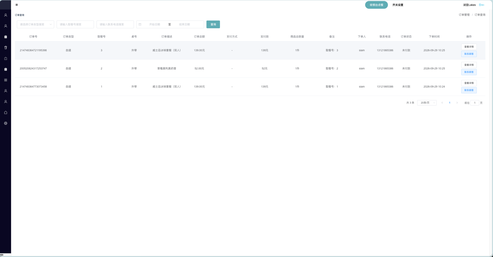

一个人维护后端，最不想干的事就是写接口文档。

不是懒。是这个东西的投入产出比太差：今天写完，明天改个字段，文档就废了；后天再加个接口，又得记得补。只要有一次忘记，后面的人（包括三个月后的我）就会开始猜——这个字段是必填吗，这个状态 1 和 2 分别代表什么，为什么我传了参数没生效。

湖里 Lakes 的后端是在开源项目上改的，接口本来就多。我让脚本扫了一遍源码，当时是 147 个 Controller、557 个活跃端点。这个量级，手写文档不是「麻烦」，是「一定写不完」。

## 问题不是文档少，是文档不可信

项目早期也写过接口文档。结果是这样：

- 文档里写着 `GET /rest/goods/list`，实际接口只认 POST；
- 字段名从 `shopId` 改成了 `shop_id`，文档没跟；
- 有些接口是原作者留下的，代码还在，但前端根本没人调；
- 同一个接口在三份文档里有三种描述，不知道信哪个。

最要命的是最后一条。文档一旦出现两个版本，读者就会开始怀疑所有内容，最后干脆不看，直接翻代码。那文档就白写了。

所以这次我换了个思路：不追求「写一份完整的文档」，追求「文档和源码永远一致」。一致的前提是，文档里的端点表不能手写。

## 让源码自己说话

Spring Boot 的接口信息都在注解里：类上的 `@RequestMapping`，方法上的 `@PostMapping`、`@GetMapping`，参数上的 `@RequestBody`。这些信息本来就是结构化的，只是散在 Java 文件里。

我写了三个脚本：

- `scan_controllers.py`：扫 Controller，抽出模块、路径、方法、请求方式，生成 `api-inventory.json`；
- `scan_dto.py`：扫 DTO 和 Param 类，展开字段和继承关系，生成 `dto-fields.json`；
- `gen_all_docs.py`：拿上面两份 JSON，生成总览和四个分册。

外面再包一层 `refresh-api-docs.sh`，把三步串起来，最后和 git 对比。


flowchart LR
  A["Controller 源码"] --> B["scan_controllers.py"]
  C["DTO / Param 源码"] --> D["scan_dto.py"]
  B --> E["api-inventory.json"]
  D --> F["dto-fields.json"]
  E --> G["gen_all_docs.py"]
  F --> G
  G --> H["总览 + 4 册接口文档"]
  H --> I["git diff"]


脚本跑完会做一件很关键的事：看 `docs/_业务/后端接口*` 有没有变化。没有变化就退出 0；有变化就列出文件，退出 3，提醒我 review 后提交。

```bash
./01-solution/refresh-api-docs.sh

# 退出码 0：文档与源码一致，不用提交
# 退出码 3：源码变了，文档已更新，等你 review
# 退出码 1：扫描或生成失败
```

这个退出码设计比脚本本身更有用。它把「要不要更新文档」从一个需要记忆的事，变成了一个命令的返回值。改完 Controller 不跑，CI 或提交前检查就能拦住。

## 五册怎么分

557 个端点塞进一个文件没法看。我按模块和调用方拆成五册：

| 册 | 内容 | 端点数 |
|---|---|---|
| 总览 | 口径、模块矩阵、分册导航、再生成方式 | — |
| package_goods | 商品、菜单、规格、购物车、商城 | 301 |
| package_order | 下单、支付、退款、订单状态 | 125 |
| package_user | 登录、会员、实名、余额 | 74 |
| 其他模块 | service、dining、points、log | 57 |

总览里有一张「模块 × 调用方」的矩阵，管理后台、商家端、顾客端各有多少个端点，一眼能看到。这个矩阵不是为了好看，是为了判断改一个模块会影响谁。比如改 `package_goods`，管理端 139 个、商家端 87 个、顾客端 70 个，改动面立刻清楚了。

管理端订单查询页就是 `package_order` 那 125 个端点在调用方的实际样子。下面这张图里的每个筛选项、每一列，背后都对应文档里的一条接口和几个字段：



扫描的时候还发现 5 个「死类」：整个类被注释掉，但文件还在。这些不算活跃端点，文档里单独标注，避免有人照着死代码去调接口。

## DTO 字段才是最容易猜错的地方

接口清单只解决了「有哪些接口」，没解决「字段是什么意思」。真实开发里，前端最常问的是：

> 这个 `status` 传 1 还是 2？
> `items` 里到底要哪些字段？
> 这个字段是必填吗？

所以第二层是把 DTO 和 Param 的字段展开。当时扫出来 49 个类、1030 个字段（含继承字段）。文档正文里，带 `†` 标记的类型会指向该册的「附录 A：DTO 字段参考」，不用再翻源码。

这一步带来的变化很直接：前端对着文档就能拼请求体，不用每次都来问我。我自己改后端时也会先看一眼附录，确认这个字段是不是被别的接口共用，避免改一个地方崩三个页面。

## 两张配套的口径表

接口文档之外，还有两张表是必须单独维护的。

第一张是数据库字段口径表。接口里的字段名、数据库里的列名、前端展示的含义，经常不是一一对应的。比如订单金额有商品小计、应付、实付、退款金额，名字都很像，口径不一样。口径表把每个字段的来源、单位、边界写清楚，改字段之前先查这张表。

这张是端口与服务对照表。这个项目的端口踩过坑：后端 yml 里写 9200，启动脚本用 `-Dserver.port` 覆盖成 9411；`PORT_SHOP` 和 `PORT_ADMIN` 两个变量名的语义是反的，看脚本时不能按字面理解；收银台是 5270，顾客端 H5 是 8010。端口散落在启动脚本、yml、旧文档里，不整理一张表，每次排查都要重新猜。

这两张表的共同点是：它们不追求「全」，只追求「改的时候知道去哪改」。口径表是字段的唯一真相源，端口表是本地环境的唯一真相源，其他文档一律链接过来，不抄数字。

## 文档也要分层，不然索引比文档还乱

接口文档只是整个文档体系的一部分。项目里还有需求、方案、实施计划、验收记录、ADR。如果全堆在一个目录，找一份文档的时间比写代码还长。

我最后把 `docs/` 分成两层：

- `docs/_体系/`：入口、规范、模板、总索引、校验脚本，变更频率低；
- `docs/_业务/`：需求、方案、实施计划、检查报告，变更频率高。

两层都在 git 里。这一点是踩坑之后改的：之前的体系层有一整套产物没被 git 跟踪，规范和模板自己没有版本历史，改坏了都找不回来。

文档本身按四种类型写：教程、操作指南、参考、解释。写之前先问「读者此刻想干什么」，只写一种，不混写。参考文档就老老实实做表格，别在里面对人讲课；教程就只留一条路，别列一堆可选项。

每篇文档开头必须有 frontmatter：标题、负责人、状态、类型、最后复核时间、复核周期。状态里有「已过期」这一项，旧文档不删，标记后保留。删掉会切断历史，标记才能让人知道「这条信息曾经正确过」。

配套的 `check-docs.py` 会检查几件事：frontmatter 是否完整、文档是否逾期、相对链接是否断、命名是否合规，以及「事实回归」——已经修正过的错误值不能重新出现，比如错误的 appid、错误的产物路径。

用 Python 而不是 grep，是因为 macOS 自带的 grep 对中文大文件会静默漏匹配。不报错，直接少匹配几行，拿它做文档校验会产生假阴性。这个坑踩过一次就够了。

## 这套东西带来的实际变化

最明显的变化是改接口的流程。以前是「改代码，想起来再补文档」，现在是「改代码，跑脚本，看 diff，一起提交」。diff 里新增了哪个端点、少了哪个字段，review 时一眼能看到。

第二个变化是新人（或者三个月后的我）找信息快了。先看总索引，再进对应的册，找不到再翻源码。文档里写清楚了「这条事实的权威源在哪」，不用在四份互相矛盾的材料里做判断。

第三个变化是数字终于统一了。项目早期，需求项数同时存在 42、43、46 三个版本，散在四处文档里。后来定了一条规矩：凡数字，只写一次，其他文档链接过来。这条规矩比任何文档模板都管用。

也要说清楚这套东西的边界：脚本只能保证「文档和源码一致」，不能保证「接口设计合理」。一个命名很烂的接口，扫描出来还是一样烂。557 这个数字后来也变了——几个模块下线之后，10 月初重扫是 545。数字会变，脚本不会，这才是重点。

## 收个尾

我不想手写文档，最后写了一套生成文档的脚本。听起来绕，但很划算：手写文档的敌人不是工作量，是它会过期；脚本生成的文档不会过期，因为它的源头就是源码。

文档不是写给现在的，是写给三个月后的自己。三个月后的我不会记得 `status=2` 是什么意思，但文档会。
