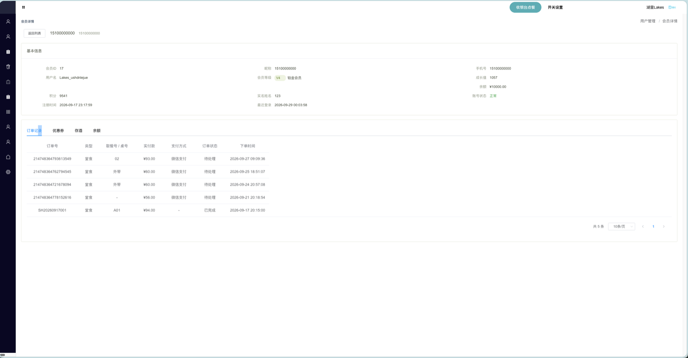
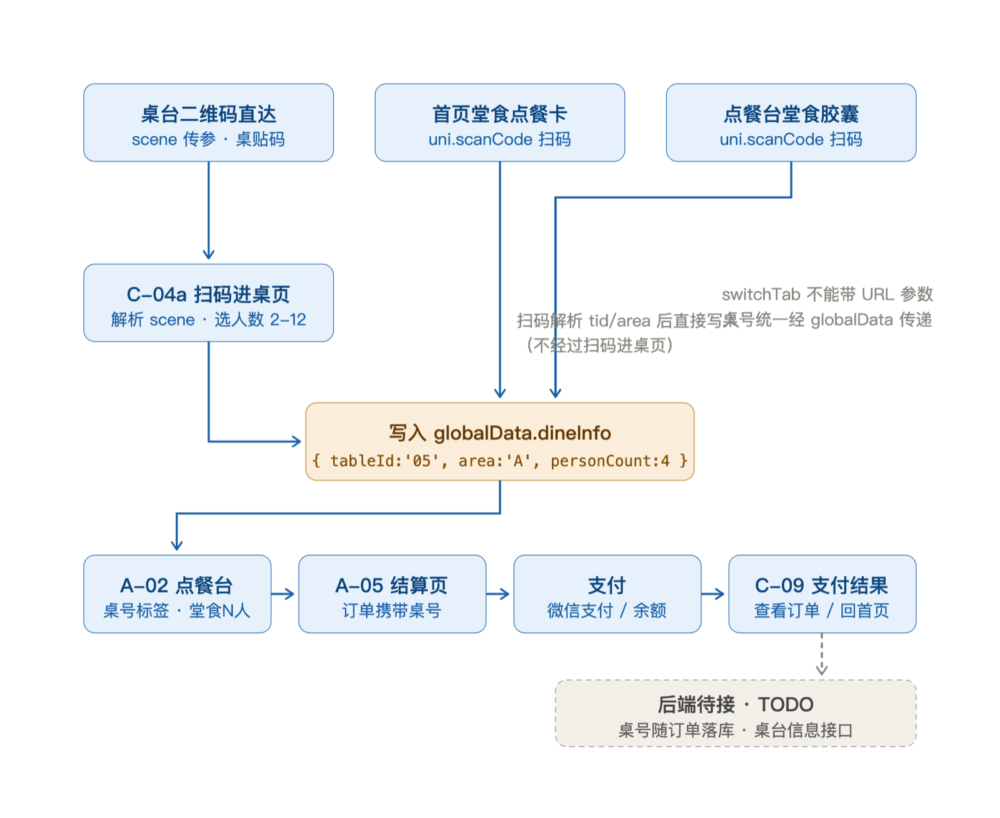

这套系统改了大半年。说是「改」，其实前半段时间都在读别人的代码。

后端用的是开源项目「暹罗点餐」，Apache License 2.0，商品、规格、购物车、订单这些骨架都有。拿到手第一天我没急着改业务，先把它跑起来：装 JDK 8、MySQL，改数据库连接，起后端，再起管理端。跑通之后做了一件看起来很笨的事——拿张纸，把它的模块和菜单画出来，用三种颜色标：能直接用、要改、完全没有。

这张图后来救了我很多次。每次想动某个模块，先看一眼它属于哪一色，心里有数。

## 先跑起来，再决定改哪

开源项目最怕的是「看起来什么都有」。菜单一点，商品、订单、会员、营销、财务报表全在，很容易产生一种「稍微配置一下就能用」的错觉。真跑起来才发现，它的默认场景是连锁品牌加同城配送，和一家单店精酿餐吧差得很远。

我当时的判断标准很简单：

| 模块 | 判断 | 处理 |
|---|---|---|
| 商品、分类、规格、菜单 | 通用骨架，逻辑完整 | 留，改字段和展示 |
| 购物车、订单主流程 | 通用骨架，状态机够用 | 留，补堂食和自提场景 |
| 门店、商家账号 | 多店模型，单店也能用 | 留，按单店收敛 |
| 上传、设置、字典 | 基础设施 | 留 |
| 会员中心、等级、积分 | 原版偏管理端，顾客端很薄 | 重写顾客端，补等级和流水 |
| 优惠券、满减 | 有券，但活动规则和核销链路不完整 | 改，统一走券 |
| 到店自提、核销、存酒 | 原版没有 | 新写 |
| 收银台 | 原版没有独立收银端 | 新写 |
| 外卖、配送、骑手、评价 | 这家店用不上 | 隐藏，不删代码 |

真正花时间的不是「写新功能」，是判断哪些旧代码可以不动。开源项目的商品规格有两层，菜单和商品是多对多，订单拆主表和明细表，这些设计比我自己从零想一遍要稳。我要做的是顺着它的模型加东西，而不是另起一套。

## 留下的部分

留下来的代码有一个共同点：它们描述的是餐饮的通用结构，不依赖某家店怎么经营。

- 商品有分类、规格、规格选项，能表达「大杯/小杯」「加冰/常温」；
- 菜单和商品是多对多，同一道菜可以挂在午餐和晚餐两个菜单里；
- 购物车按会员和门店存，下单时转成订单主表和明细表；
- 订单有状态、支付方式、退款记录，主流程能跑；
- 门店和商家账号绑定，后端用登录会话里的 `shopId` 做数据隔离。

这些表结构我基本没动。动得最多的是「哪些字段在顾客端展示」「哪些菜单要隐藏」。比如外卖、配送、骑手、评价这几个一级菜单，店里用不上，直接在前端路由里隐藏，后端接口留着不调。删代码看起来更干净，但以后想加回来成本更高，隐藏是更划算的选择。

## 重写的部分

重写的判断标准不是「代码写得烂」，是「它的假设和这家店对不上」。

### 会员中心

原版有会员表，也有管理端的会员列表，但顾客端能看的东西很少。店里想要的是：客人打开「我的」，能看到等级、成长值、积分、余额、优惠券，还有存酒。

这部分在顾客端基本重写。等级和成长值是新加的，积分和余额各自有流水，优惠券单独一个入口。管理端对应补了会员详情，订单、优惠券、存酒分 Tab 展示。

### 优惠券和满减

原版有优惠券，但活动配置和核销链路比较粗。我补了券模板、领取、券包、下单选券、核销状态这些环节。

中间走过一段弯路：商城那边同时存在「自动满减规则」和「满减券」，两套都能减钱。更麻烦的是自动满减的开关在前端三处计算里都没判断，管理端关了照样减。后来干脆把商城的自动满减下线，满减统一用券表达。这个决定单独写了一份 ADR，后面讲。

### 到店自提和核销

原版没有自提。新写的部分包括：商城里标记可自提的商品、下单生成自提码、收银端核销页面、核销记录。自提码第一版是顺序编号，后来发现可枚举，这是后话，测试那篇会提到。

### 收银台

原版没有独立的收银端。新写的 `cashier-web` 是一个 Vue 3 应用，负责开台、点单、结账、退款、打印、核销。它和管理端不是同一套代码，后面单独讲为什么。

### 扫码点餐链路

桌台码里带桌号和区域，扫码进来先解析参数，写进 `globalData.dineInfo`，再进点餐页。堂食点餐的入口有三个：桌台二维码直达、首页点餐卡、点餐页右上角的扫码胶囊。三条路最后都汇到同一个上下文对象，避免每个页面各自解析一遍。

## 四个工程怎么连

系统拆成四个工程，各自负责一件事：

| 工程 | 技术 | 本地端口 | 职责 |
|---|---|---|---|
| `siam-server` | Spring Boot 2.3 + MyBatis-Plus + MySQL | 9411 | 全部接口、支付、订单、会员 |
| 管理端 `vue-siam-shop` | Vue 2 + Element UI + ECharts | 5271 | 商品、订单、会员、营销、报表 |
| 收银台 `cashier-web` | Vue 3 + Vite + Pinia + Tailwind | 5270 | 开台、点单、结账、打印、核销 |
| 顾客端 `customer-cli` | uni-app，编译到微信小程序 | 8010（H5 预览） | 扫码点餐、商城、会员、订单 |

四者之间没有花哨的通信，都是 HTTP + JSON。后端 context-path 是 `/siam-server`，本地请求要写成 `http://localhost:9411/siam-server/rest/...`，登录后令牌放在 `Authorization` 头里。


flowchart LR
  MP["顾客端小程序"] -->|"HTTP JSON"| API["Spring Boot 后端"]
  WEB["管理端 Vue2 + Element"] -->|"HTTP JSON"| API
  POS["收银台 Vue3 + Vite"] -->|"HTTP JSON"| API
  API --> DB[("MySQL")]
  API --> PRT["小票打印机"]


有一个约束值得记下来：业务接口统一用 POST + JSON body。这个项目里 GET 请求带 query 参数会被全局异常处理器吞成「系统异常，请稍后重试」，响应体看不出真正原因，只能去翻后端日志。刚开始我不信，试了两次才老实。

## 收银端为什么单独做一个 Vue 应用

最直接的原因是设备。收银员用的是 Pad 或者店里的旧笔记本，横屏，屏幕大，要在一屏里塞下桌台、订单、金额、优惠、支付方式。小程序的交互模型是为手机竖屏设计的，放到 Pad 上很别扭。

第二个原因是外设。收银台要接小票打印机，后面还想接标签打印机和扫码枪。浏览器里做这些事更直接，小程序要走蓝牙或云打印，链路更长。

第三个原因是更新节奏。顾客端要走微信小程序审核，收银端是店里内部用的 Web 应用，改完 build 一下就能换。把两者绑在一起，改一个收银按钮也要等审核，不划算。

代价是多维护一个工程。收银端现在有三十多个 Vue 文件，路由、状态、接口封装都要自己写。但它的边界很清楚：只服务店里，不面向顾客，出了问题影响范围可控。

## 库表大概长这样

表不少，真正核心的是这些：


erDiagram
  tb_shop ||--o{ tb_merchant : "拥有"
  tb_shop ||--o{ tb_menu : "配置"
  tb_menu ||--o{ tb_menu_goods_relation : "包含"
  tb_goods ||--o{ tb_menu_goods_relation : "被挂到"
  tb_goods ||--o{ tb_goods_specification : "有规格"
  tb_goods_specification ||--o{ tb_goods_specification_option : "有选项"
  tb_member ||--o{ tb_shopping_cart : "加购"
  tb_member ||--o{ tb_order : "下单"
  tb_order ||--o{ tb_order_detail : "包含"
  tb_goods ||--o{ tb_order_detail : "对应"
  tb_member ||--o{ tb_coupons_member_relation : "领券"
  tb_coupons ||--o{ tb_coupons_member_relation : "被领取"
  tb_shop ||--o{ tb_dining_table : "有桌台"
  tb_member ||--o{ tb_wine_storage : "存酒"


拆开看就三组：

- 卖什么：`tb_goods` 是商品，`tb_goods_specification` 和 `tb_goods_specification_option` 管规格，`tb_menu` 把商品组织成菜单；
- 怎么卖：`tb_shopping_cart` 是加购，`tb_order` 和 `tb_order_detail` 是订单主表和明细；
- 卖给谁：`tb_member` 是会员，`tb_coupons` 和关系表管券，`tb_wine_storage` 管存酒。

门店和商家账号是数据隔离的边界。后端所有商家接口都用登录会话里的 `shopId` 过滤，前端传什么都不作数。这个设计省了很多「忘记加门店条件」的 bug。

## 决策留痕：我为什么开始写 ADR

改别人代码最容易出现的问题，是同一个词在不同文档里指不同的东西。

这个项目里最典型的是「商家端」。有一份文档说 `vue-siam-shop` 是商家端，另一份说它是管理端；收银台有时候叫收银端，有时候叫商家端。名字一乱，需求编号 `M-` 和 `A-` 就不知道该归谁，验收清单也没法和覆盖报告对上。

为这事我写了第一份 ADR，把三端和工程锁死：`vue-siam-shop` 是管理端，承载 `A-` 编号；收银台是商家端的作业界面，承载 `M-` 和 `P-`；老的 `vue-siam-admin` 不再作为运行端，只留作参考。被否决的方案也写进去了，比如「按工程名重新命名」看起来最干净，但会破坏构建脚本和部署路径，收益不抵风险。

第二份 ADR 是商城满减下线。两套优惠机制并行，开关还关不掉，这种情况下不写下来，过两个月一定有人问「为什么这里不能配满减」。ADR 里把假开关的代码位置、双重优惠的风险、历史订单字段为什么保留都写清楚了。

ADR 不是给领导看的文档。它是给三个月后的自己看的：当时为什么这么选，试过哪些不行的路，什么情况下应该重新评审。没有它，很多决定会变成「代码里就是这么写的」，没人知道能不能改。

## 收个尾

在开源项目上改，最重要的不是改得多，是知道自己在改什么。留下的部分要有理由，重写的部分更要有理由。四个工程的分工、几张核心表的关系、两个 ADR，基本就是这套系统的骨架。

下一篇写接口文档。后端有一百多个 Controller，手写文档一定会过期，我最后让脚本去扫源码。
