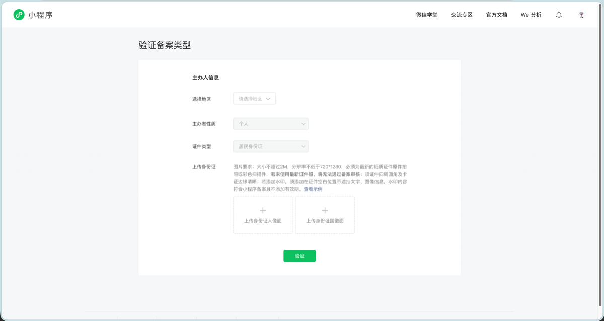

湖里 Lakes 是给朋友的精酿餐吧做的点餐系统。代码在本地跑通只是第一步，真正难的是让店里的人每天打开就能用，而且我不用半夜起来重启服务。这篇记录把它搬到微信云托管的过程，包括容器怎么改、密钥放哪、支付回调怎么通，以及那些只有真正发过版才会遇到的坑。

## 为什么选云托管

一开始我认真算过买服务器这条路。一台最低配的云服务器，加上域名、备案、HTTPS 证书、MySQL、Nginx 反向代理、日志轮转、安全组，东西不算多，但每一样都要人管。证书三个月到期一次，数据库要记得备份，系统补丁要打。这个项目只有我一个人，白天还有别的事，代码之外的运维能省就省。

云托管吸引我的地方很直接：

- 不用碰服务器，容器跑起来就有默认域名和 HTTPS，证书不用自己续；
- 小程序里用 `wx.cloud.callContainer` 调后端，走微信内网，少一套鉴权；
- 按量计费，没人访问时副本可以缩到 0，对小店这种流量很合适。

代价也有：容器、镜像、构建、版本这些概念要学一遍；冷启动第一次请求会慢；日志和排障不如自己 SSH 上去顺手。但和长期运维比，我认这个代价。

## 要部署的东西有几样

系统拆成了两个云托管服务。

| 服务 | 内容 | 容器端口 |
|---|---|---|
| `bar-mvp` | Spring Boot 后端，负责接口、支付、数据库 | 9200 |
| `bar-web` | Nginx 静态包，装商家端、管理端、收银台 | 80 |

前端其实有三个产物，放在同一个 Nginx 容器里，用路径区分：

| 访问路径 | 产物来源 | 说明 |
|---|---|---|
| `/` | `vue-siam-shop/dist` | 商家端，也是店里的管理端 |
| `/admin/` | 同一份产物副本 | 双入口兼容 |
| `/cashier/` | `cashier-web/dist` | 收银台，商家端 iframe 里打开 |

后端则是一个 Spring Boot 源码包，云端用 Dockerfile 里的 Maven 构建，不把本地打好的 jar 传上去。这样版本和源码对得上，换台电脑也能发版。

## 容器化改造

后端用的是多阶段构建。构建阶段用 JDK8 + Maven，运行阶段只留 JRE，镜像能小不少。真实用的 Dockerfile 大致是这样：

```dockerfile
FROM maven:3.8-openjdk-8 AS builder
WORKDIR /build

RUN mkdir -p /root/.m2 && printf '<?xml version="1.0" encoding="UTF-8"?>\n\
<settings xmlns="http://maven.apache.org/SETTINGS/1.0.0">\n\
  <mirrors>\n\
    <mirror>\n\
      <id>aliyun-public</id>\n\
      <mirrorOf>central</mirrorOf>\n\
      <url>https://maven.aliyun.com/repository/public</url>\n\
    </mirror>\n\
  </mirrors>\n\
</settings>\n' > /root/.m2/settings.xml

COPY pom.xml ./
COPY siam-common/pom.xml ./siam-common/
COPY siam-weixin/pom.xml ./siam-weixin/
COPY siam-weixin/weixin-basic/pom.xml ./siam-weixin/weixin-basic/
COPY siam-weixin/weixin-pay/pom.xml ./siam-weixin/weixin-pay/
COPY siam-system/pom.xml ./siam-system/
COPY siam-system/system-api/pom.xml ./siam-system/system-api/
COPY siam-system/system-provider/pom.xml ./siam-system/system-provider/
COPY siam-monitor/pom.xml ./siam-monitor/
RUN mvn -q -pl siam-system/system-provider -am dependency:go-offline -DskipTests || true

COPY siam-common ./siam-common
COPY siam-weixin ./siam-weixin
COPY siam-system ./siam-system
COPY siam-monitor ./siam-monitor
RUN mvn -q -pl siam-system/system-provider -am package -DskipTests \
 && cp siam-system/system-provider/target/siam-server.jar /build/app.jar

FROM eclipse-temurin:8-jre
RUN apt-get update \
 && apt-get install -y --no-install-recommends fontconfig fonts-dejavu-core \
 && rm -rf /var/lib/apt/lists/*

ENV TZ=Asia/Shanghai \
    SPRING_PROFILES_ACTIVE=mvp \
    JAVA_OPTS="-XX:MaxRAMPercentage=70.0 -XX:+HeapDumpOnOutOfMemoryError -Duser.timezone=Asia/Shanghai -Djava.awt.headless=true"

WORKDIR /app
COPY --from=builder /build/app.jar /app/app.jar
EXPOSE 9200
ENTRYPOINT ["sh", "-c", "exec java $JAVA_OPTS -jar /app/app.jar"]
```

几个地方是踩过才加的。

先拷 `pom.xml` 再拷源码，是为了让依赖下载单独成层。改一行 Java 代码重新构建时，Maven 不用把依赖再下一遍。`siam-monitor` 本身不参与运行，但父 pom 的 `<modules>` 里声明了它，少拷一个 pom 就会报子模块找不到。

运行阶段装 `fontconfig` 和字体，是因为桌码图片是服务端用 Java2D 画的，容器里没有字体会直接抛 AWT 异常。这个错误本地永远复现不了，本地 Mac 有字体。

`SPRING_PROFILES_ACTIVE=mvp` 也写进了镜像默认值。有一次忘了配这个变量，容器用 `local` profile 启动，数据源指向容器内的 `127.0.0.1`，健康检查居然还是 UP，接口一调就报错。这种“假健康”比直接启动失败更难查。

前端那个容器简单一些，但坑在入口脚本：

```dockerfile
FROM nginx:alpine

COPY dist/shop/ /usr/share/nginx/html/
COPY dist/admin/ /usr/share/nginx/html/admin/
COPY dist/cashier/ /usr/share/nginx/html/cashier/
COPY nginx.conf /etc/nginx/conf.d/default.conf

RUN nginx -t

ENTRYPOINT ["nginx", "-g", "daemon off;"]
```

`nginx:alpine` 自带的 `docker-entrypoint.sh` 会先跑一段 `sed` 去改配置。云托管的容器文件系统有只读限制，那段脚本执行失败，因为 `set -e`，后面的 nginx 也不会启动，表现就是 80 端口一直拒绝连接、健康检查失败。必须用 `ENTRYPOINT` 直接覆盖，写成 `CMD` 没用，官方镜像的 `ENTRYPOINT` 还会继续执行。

Nginx 配置本身不复杂，三个目录各自回退到自己的 `index.html`：

```nginx
server {
    listen 80;
    server_name _;
    root /usr/share/nginx/html;
    index index.html;
    gzip on;
    gzip_types text/css application/javascript application/json image/svg+xml;

    location / { try_files $uri $uri/ /index.html; }
    location /admin/ { try_files $uri $uri/ /admin/index.html; }
    location /cashier/ { try_files $uri $uri/ /cashier/index.html; }

    location = /healthz { return 200; }
}
```

前端产物都是 hash 路由，`try_files` 其实不是必须的，留着是为了以后万一改成 history 路由不用再动配置。

## 环境变量与密钥

数据库密码、对象存储的 AccessKey、微信支付的商户号和密钥，一个都不能进镜像。镜像会被拉取、会被缓存，写进去就等于公开。这些全部放在云托管服务的环境变量里，发版时不动。

后端实际用到的变量大致分四组：

| 分组 | 变量 | 用途 |
|---|---|---|
| 运行环境 | `SPRING_PROFILES_ACTIVE` | 固定 `mvp`，决定读哪份配置 |
| 数据库 | `MYSQL_ADDRESS`、`MYSQL_USERNAME`、`MYSQL_PASSWORD` | 云托管 MySQL 连接信息 |
| 对象存储 | `ALIYUN_OSS_KEY`、`ALIYUN_OSS_SECRET`、`ALIYUN_OSS_PRIVATE_BUCKET` | 商品图、证件材料 |
| 微信 | `WXPAY_APPID`、`WXPAY_MCHID`、`WXPAY_MCHKEY`、`WXPAY_NOTIFY_URL`、`WXLOGIN_APPID`、`WXLOGIN_SECRET` | 登录与支付 |

配置里读的都是 `${MYSQL_PASSWORD}` 这种占位，没配就是空字符串。这里有个设计取舍：对象存储的私有桶变量如果缺失，上传会直接报“未配置”，而不是悄悄传到默认桶。宁可报错，也别把证件照传到公开桶里。

密钥的具体值这里就不写了，统一按已脱敏处理。真要交接，走密码管理器，不要贴在文档或聊天记录里。

## 微信支付回调

支付这块最容易卡住。下单接口能返回，支付也能拉起，但钱付完之后订单状态不变，多半是回调没进来。

回调地址通过 `WXPAY_NOTIFY_URL` 配，必须满足两个条件：公网能访问，而且是 HTTPS。云托管的默认域名本身带 HTTPS，可以直接用；后来绑了自定义域名 `api.show.siamit.cn`，回调地址也跟着换成了这个域名下的路径。

排查验签失败时，我一般按这个顺序看：

1. 微信支付后台配置的回调地址，和 `WXPAY_NOTIFY_URL` 是不是完全一致，包括协议、域名、路径，多一个斜杠都不行；
2. `WXPAY_APPID`、`WXPAY_MCHID`、`WXPAY_MCHKEY` 是不是同一套商户资料，测试环境和正式环境经常混；
3. 回调接口有没有被网关或框架提前消费掉请求体，验签要用原始报文，读过一次流后面就空了；
4. 容器日志里有没有收到请求。如果连日志都没有，问题在网络层，不在签名。

还有一点，支付回调是微信服务器主动发的，和用户手机在不在线没关系。所以本地开发时用内网穿透拿到的临时地址只能测通链路，正式上线必须换成备案过的固定域名。

## 域名与备案

云托管给每个服务一个默认域名，形如 `https://bar-mvp-xxxx.sh.run.tcloudbase.com`，开箱就能用，HTTPS 也不用自己配。前期我一直用默认域名，省事。

后来要绑自己的域名，流程就绕不开了：域名实名、ICP 备案、在云托管控制台绑定、配证书。备案期间域名不能对外提供访问，所以这一步最好提前做，别等上线前一天才想起来。

另外，小程序本身的备案和域名备案是两件事。小程序要在微信后台提交主体和类目资料，域名备案是另一套系统。我当时在小程序后台填资料，页面大概是这样：



截图里只留了页面结构，证件信息都避开了。这一步填完还要等审核，时间不完全可控，排期的时候要留余量。

## 发版流程与批次归档

云托管有两个概念容易混：上传代码包和发布版本。上传只是创建了一个新版本，流量还在旧版本上；必须再点发布，或者用 CLI 的 `run:deploy` 一次做完，新版本才真正接流量。

后端发版用脚本，核心命令是：

```bash
wxcloud run:deploy ./deploy/context \
  -e prod-d6gd6a2twe27f592a -s bar-mvp --region ap-shanghai \
  --containerPort 9200 --dockerfile Dockerfile --targetDir . \
  --releaseType FULL --noConfirm --remark "本次改了什么"
```

`--targetDir .` 和 `--remark` 必须显式给。少第一个会弹交互菜单，非交互环境直接报 readline 错误；少第二个会卡在“请输入版本备注”。这两个坑我各踩过一次。

前端是另一个脚本，把三个 `dist` 同步到一个目录，打包、解压、再发到 `bar-web`，端口 80。前端产物构建有个历史包袱：商家端是 Vue2 + webpack4 + node-sass，必须用 Node 12 x64，不然 `node-sass` 的 ABI 对不上，装依赖就失败。收银台是 Vue3 + Vite，用现在的 Node 反而正常。两个工程在同一台机器上构建，切 Node 版本这件事一直很烦。

每发一次版，我会在 `docs/_业务/云托管/` 下留一份批次记录，文件名带日期和三个载体的版本号，比如 `已发布-20261002-barmvp046-barweb054-mp1.2.3.md`。里面固定写几块：

- 批次元信息：主题、登记日、涉及哪些载体、前置依赖；
- 内容清单：后端改了什么、前端改了什么、小程序改了什么、有没有 DDL/DML；
- 发版顺序和验证探针：先发谁后发谁，发完用什么接口或页面证明新代码真的在跑；
- 发布结果：时间、版本号、验证证据、回滚版本、有没有夹带别的改动。

这套东西看起来像流程负担，但真出问题时很有用。有一次线上改单报 500，我翻批次记录，十分钟内就定位到是某一版漏传了字段，回滚也有明确的上一版版本号，不用猜。

## 踩坑记录

把印象最深的几个列一下，都是实际撞过的。

**上传成功不等于发布成功。** CLI 提示“部署完成”不代表新版本在接流量，要用 `wxcloud version:list` 看新版本状态是不是 `normal`。有一次我发完没看，第二天发现线上还是旧代码。

**构建上下文不能传仓库根目录。** CLI 打包不读 `.dockerignore`，把整个仓库传上去会把前端工程、`.git`、`node_modules` 全带上，体积几百 MB，版本长时间卡在 `creating`。后端只用裁剪过的 `deploy/context`，几百个文件、不到 10 MB。

**代码包上传报 400，先怀疑本机代理。** CLI 内部上传用的 axios 会读 `HTTPS_PROXY`，把 HTTPS 请求当成明文发给代理，代理返回 400，CLI 再兜成一个看不懂的“代码包上传失败”。临时办法是命令前加 `NO_PROXY='*'`，长期办法是给 CLI 打补丁。

**冷启动会超时。** 副本缩到 0 之后，第一个请求要等容器拉起来，后端 Spring Boot 加上数据库连接，一两分钟很正常。健康检查的初始延迟要给够，前端首屏也要接受第一次慢。店里早上第一单之前，最好有人先打开一次。

**容器时区。** 不配 `TZ` 和 `-Duser.timezone`，容器默认 UTC，订单时间会比北京时间少 8 小时。这个错误不会报错，只会让报表和日志看起来很奇怪。

**静态资源 404 和缓存。** 前端发版后页面没变，先硬刷新，`index.html` 缓存很顽固；再看线上引用的 JS hash 和本地 `dist` 是否一致。如果整个页面 404，检查 Nginx 的 `ENTRYPOINT` 和目录映射，别只看构建日志。

**容器里调微信接口报证书错误。** 云托管控制台有个“开放接口服务”开关，开了之后容器里会装一份自签名证书，Java 不认，报 `PKIX path building failed`。关掉重新部署就好。

**日志里有噪音。** 构建日志里的 `ResourceNotFound.TopicNotExist` 和旧版本日志都不是本次发版的问题，别被带偏。真正要看的是新版本的构建结果、健康检查和业务接口返回。

## 上线后的状态

现在店里在用，后端和前端各一个服务，副本最小 0，流量不大，每个月的账单还能接受。冷启动的几秒到一分钟，放在餐饮场景里可以接受，毕竟不是每秒都有人下单。

还没有做得很好的地方也记一下：数据库备份目前只做了最基础的定时备份，没有单独做异地备份；监控只有健康检查，没有告警；小程序每次发版还要人工上传、提审。一个人维护的项目，这些就先留着了。等店里真忙起来，再按优先级补。
