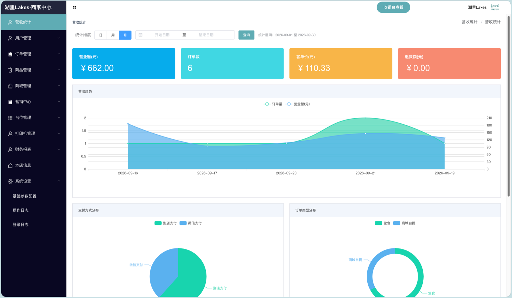
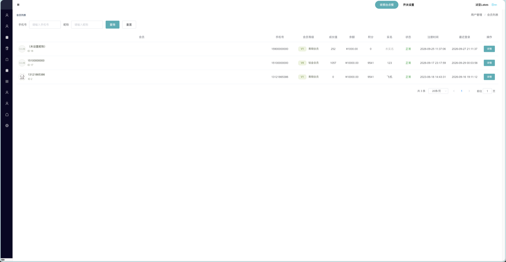
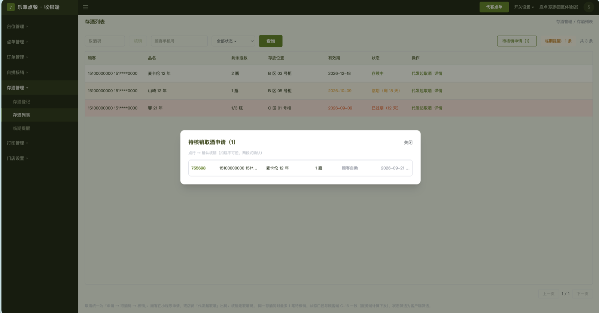

湖里 Lakes 是朋友开的一家精酿餐吧。我去吃饭那天是周五，店里满座，服务员拿着小本子一桌一桌记，字写得飞快；后厨和收银台之间靠喊，「3 号桌加一份薯条」「门口那位买单」。中途来了两个客人要外带，服务员拿张便签记了酒名，转头去忙别的，那张便签就再也没出现过。

这场景不算新鲜，但对我挺有冲击。店主不是没想过办法，他用过扫码点单的 SaaS，也试过让客人自己写纸条，最后都回到服务员记单。原因很具体：要么菜单对不上店里的酒，要么改个价格要等平台审核，要么收银和点单是两套数据，晚上对账还得再算一遍。

这是我做的第二个小程序项目。第一个是给学校视觉中心做的任务派发工具，需求方是自己人，沟通靠吼就行。这次面对的是真实经营，需求不是「我想要一个什么功能」，而是「我这一天哪里最难受」。

## 先看店里怎么运转

我在店里待了几个晚上，没急着画原型，先看他们怎么干活。

- 客人坐下，服务员递菜单，等几分钟，记在纸上，送到后厨；
- 高峰期服务员不够，点单排队，后厨出餐也排队；
- 客人吃完喊买单，收银台翻本子算钱，碰上优惠或者会员余额，还要再查一遍；
- 外带和存酒是另一套记录，有时候写在纸上，有时候靠店员记在脑子里；
- 打烊后店主对账，微信、现金、会员余额分开算，经常对不上。

这些事拆开看都不复杂，麻烦在于它们各记各的。菜单在后厨，价格在收银台，会员在另一个本子，外带靠便签。只要有一个环节漏了，最后都要店主自己补。

所以需求第一步不是列功能，是把「客人进店、点单、吃饭、结账、出门，这件事经过谁的手」写清楚。画完那张图，四个模块自然就出来了。

## 四个模块对应四个经营问题

### 扫码点餐：高峰期缺的是人手

桌台码贴在桌上，客人用微信扫，进来就是这家店的菜单，选人数，加菜，下单。订单直接进后厨和收银台，不用服务员再抄一遍。

看起来只是把纸菜单搬到手机上，真正省事的是后面几步：桌号跟着订单走，后厨知道菜送哪桌；加菜不用重新喊人；客人自己能看到点了什么、多少钱。对店里来说，少一次「记错桌」和「漏记菜」，比少雇一个服务员更现实。

桌台码里带了桌号和区域，扫码进来先确认人数，再进点餐页。这个链路听着简单，实际做的时候坑不少，后面架构那篇再细说。

### 收银端：结账和对账要在一处

收银台是店里最不能出错的地方。客人站着等，后面还排着队，收银员要在一屏里看到桌号、订单、金额、优惠、支付方式，还要能开台、并台、转台。

我一开始想用小程序做收银，后来放弃了。收银员用的是 Pad 或者店里的旧笔记本，屏幕横着，信息密度高，还要接小票打印机。这些事小程序做起来别扭，所以收银端单独做了一个 Vue 应用。

收银端不只是收钱。它还要能看今天的订单、处理退款、打印小票、核对会员余额。店主原话是「我晚上对账不想再开三个页面」。

### 会员与优惠券：让回头客有理由再来

精酿餐吧的客人重复率很高，店主想记住常来的人。原话不是「我要一套会员体系」，而是「那个每周五都来的大哥，能不能给他留一瓶酒」。

落到系统里就是几件事：手机号登录、会员等级、积分、余额、优惠券。等级和积分是给客人看的，余额和券是给店里做活动的。优惠券这块我后来改过一次方向，原来想同时做「自动满减」和「满减券」，后来发现两套规则会打架，干脆统一走券，这是后话，架构那篇会写。

### 自提核销：外带不该和堂食抢收银台

店里卖瓶装酒和周边，客人可以线上下单，到店自提。第一版没打算做在线支付，链路是：下单，拿到自提码，到店给店员看，店员核销，门店收款。

这样做的好处是把「外带」从收银台的高峰里摘出去。客人不用排队等结账，店员也不用在收银系统里翻半天。核销页面要能看到自提码、客人手机号、商品和数量，点一下确认，状态就变了。

## 4 个 Tab 是怎么定的

顾客端第一版按设计稿做成 4 个 Tab：首页、点餐、商城、我的。

- 首页放门店信息、活动、点餐和商城的入口，客人进来先知道这是哪家店；
- 点餐是主链路，扫码进来也落在这里；
- 商城放瓶装酒和外带商品，和堂食菜单分开，避免点餐页太长；
- 我的放订单、会员卡、优惠券、存酒这些个人资产。

后来订单多了，订单中心被单独拎成一个 Tab，代码里现在是 5 个。但骨架还是这 4 个，订单中心只是把「我的」里面最常用的入口提了出来。

定 Tab 的时候我犯过一个错：想把所有功能都塞进首页，觉得这样客人不用找。设计稿打脸得很快，首页塞满入口之后，最重要的「点餐」反而不显眼。后来首页只留三块：门店、活动、两个主入口。剩下的都退到二级页面。

## 技术选型：在开源项目上改，不从零写

后端我没有从零写。点餐系统的商品、规格、购物车、订单这些骨架，开源项目已经跑了很多年，自己重写一遍除了练习没别的收益。我用的是开源项目「暹罗点餐」（Apache License 2.0），在它的基础上改。

具体分工是这样：

- 后端：Spring Boot + MyBatis-Plus + MySQL，基于暹罗点餐改；
- 顾客端：uni-app，编译成微信小程序；
- 管理端：Vue 2 + Element UI，开源项目自带，改菜单和业务；
- 收银端：Vue 3 + Vite + Tailwind + Pinia，新写的，没用 Element。

选 uni-app 的理由很实际：店里以后可能还要一个 H5 版本，uni-app 一套代码能编译到小程序和 H5。收银端单独用 Vue 3，是因为它只跑在 Pad 和 PC 上，不需要跨端，直接用浏览器能力更顺手。

这里要诚实说一句：这不是「自研了一套点餐系统」，是「在一个能跑的开源系统上，把和这家店对不上的地方改掉」。哪些留、哪些重写，下一篇专门写。

## 第一期做到哪为止

需求最容易失控的地方，是聊着聊着什么都想做。所以第一期我列了一张「不做什么」的清单：

- 不做外卖和配送，店里没有骑手，也没有配送范围；
- 不做骑手端、评价、外卖订单这些菜单，先隐藏；
- 按单店做，不做多门店切换和门店对比；
- 商城第一期不含在线支付，先走到店核销、门店收款；
- 身份认证、短信、微信注册这些先放后面，等主体和资质落定再说；
- 打印先接小票，标签打印和云打印放到二期。

这张清单比功能清单更重要。每次有人提新想法，我先问一句「第一期不做会怎样」。大部分想法答案是「不会怎样」，那就记下来，不进这一期。

## 需求文档最后长什么样

真正落到文档里，不是一份「功能列表」，而是按「端 + 编号」组织的一本需求书。客人端是 `C-`，商家端是 `M-`，管理端是 `A-`，打印是 `P-`，实施是 `B-`。每个编号对应一条需求，验收的时候按编号打勾。

管理端那部分我单独整理了一份落地计划，把散在需求书、原型和聊天记录里的条目收成一张表：A 组 9 项加营销组 4 项，每项固定写八个字段——需求定义、现状核对、差距、落地路径、优先级、验收要点、依赖、待裁定。

这份文档最大的作用不是给店主签字，是让我自己别飘。写着写着容易觉得「这个功能顺手就做了」，一看「待裁定」那栏还空着，就知道这个决定还没人拍板，不能假装它会自己变清楚。

## 收个尾

需求理到最后，其实就三句话：先看店里怎么干活，再决定系统做什么；每个功能都要对应一个具体的经营问题，对应不上就砍；第一期一定要有「不做什么」的清单。

这套方法不高级，但它让我在后面改代码的时候少了很多「这个到底要不要做」的犹豫。下一篇写拿到开源项目之后，我怎么判断哪些留下、哪些重写。
