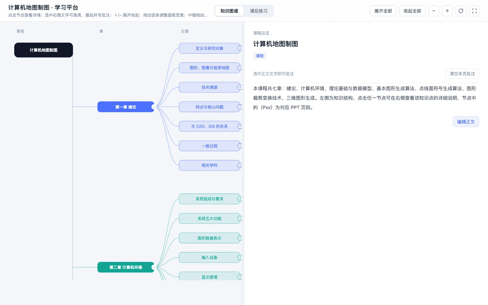
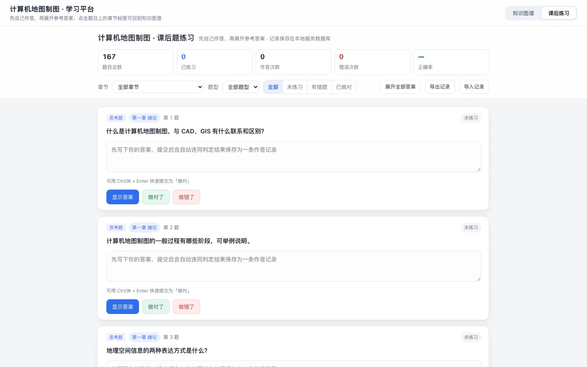

## 前言

复习一门课的时候，资料通常是散的：课件截图在一个文件夹里，作业和思考题在另一个文档里，错题和自己的笔记又在别处。这学期学计算机地图制图，我把这几样东西合成了一个页面——导图页签是七章知识树加右侧正文，练习页签是 167 道题，两个页签可以互相跳转。

整站没有框架、没有打包、没有 npm 依赖。直接双击 HTML 就能打开；想持久化数据就 `node server.js`，作答记录和批注会写进 SQLite。

## 时间线（按 git 记录）

先把时间说清楚。这个仓库的提交历史很短：

- **2026-11-03 14:37**：唯一一次提交 `feat: 初始化计算机地图制图学习平台仓库`，全部代码、数据与文档在这一 commit 里入库。
- **2026-11-03 14:47**：仓库在 GitHub 上创建。
- **截至 2026-11-14**：`main` 分支没有新的 commit。

所以 git 只能给出这一个时间点，拆不出阶段性的开发过程。下面按仓库里的实际文件来讲。

## 页面长什么样

顶部是两个页签。导图页签里，画布上是一棵可以用中键拖动、Ctrl+滚轮缩放的 SVG 树，右侧面板显示当前节点的正文；中间的竖条可以拖动调整面板宽度，双击恢复默认。练习页签是题卡列表，顶部一排统计：题目总数、已练习、作答次数、错误次数、正确率。



数据结构上，知识树分四层：课程 → 章 → 主题 → 要点。当前是 1 个根节点、7 章、53 个主题、227 个要点。节点名里的 `（Pxx）` 会被解析成页码，在面板底部自动插入对应的课件截图。

## 题库：167 道题

题库共 167 道，按来源分是作业 88、思考题 55、押题 24；按题型分是选择题 97、判断题 10、简答题 2、综合题 3、课后题 55。章节分布如下：

| 章节 | 题量 |
| --- | --- |
| 第一章 绪论 | 20 |
| 第二章 计算机环境 | 20 |
| 第三章 理论基础与数据模型 | 33 |
| 第四章 基本图形生成算法 | 39 |
| 第五章 点、线、面符号生成算法 | 24 |
| 第六章 图形裁剪变换技术 | 17 |
| 第七章 三维图形生成 | 14 |



三种来源对应卡片上三种颜色的标签。每题有唯一 `id`，作答记录以它为主键——改 id 等于把这道题的记录丢了。章节字段必须和导图里的章名一致，这是后面联动的依据。

功能上做了三件小事：判断对错并累计作答次数、错误次数；每题可以写笔记；记录能导出成 JSON，也能导入覆盖，导入前会弹确认。另外有章节、题型、状态三个筛选器，以及一个「一键展开答案」的按钮。

## 两个页签怎么联动

单靠两个独立页面是做不到双向跳的，所以 `app.js` 做了一层转发：视图模块之间互相不认识，只往外抛回调。

- 点题卡上的章节标签 → `QuizView` 调 `onGoToChapter` → `app.js` 转给 `MapView.focusChapter`，导图展开并滚动到该章；
- 导图面板里的「练习本章题目」→ `onPracticeChapter` → 切到题库页签并 `jumpToChapter`；
- 题卡下方的「相关知识点」→ `onGoToNode` → 定位到具体节点。

第三项麻烦一点：题目到知识点的映射要同时读题库和导图，属于跨模块逻辑，所以 `app.js` 把 `findNodes` 注入给 `QuizView`，按关键词匹配本章节点。押题部分的解析我逐个核对过，直接写了一张覆盖表指定节点，避免关键词匹配错位。

```js
const KP_OVERRIDE = {
  y01: ["核心：图形与数字互转（P17）"],
  y02: ["图形：矢量、算法描述（P12）", "图像：位图、像素点阵（P12）"],
  // ...
};
```

## 正文批注

右侧正文支持划词高亮、写备注、方框圈划，用 `web-highlighter` 和 `rough-notation` 两个库，都是本地文件放进 `vendor/`，不走 CDN。批注按知识点路径分别保存，切回该节点时自动回填。

这里的顺序是踩过的坑：`mount` 时必须先清理上一节点的圈划、再清空高亮器缓存、然后回填历史批注、重画圈划、最后重建批注列表。顺序调换，锚点就会错位到别的节点上。

## 数据存在哪

存储层只有 `Store.get(key)` 和 `Store.set(key, value)` 两个 Promise 接口，内部做了降级：

- 页面通过 HTTP 打开时，先请求本地服务的 `/api/store/:key`；
- 请求失败或直接用 `file://` 打开时，退回 `localStorage`；
- 写入时先落 `localStorage`，再尝试 PUT 到服务，写失败至少本地还有一份。

服务端是 155 行的 `server.js`，用 Node 内置的 `node:sqlite`，不需要 `npm install`。库里只有一张 `kv` 表（`key`、`value`、`updated_at`），写操作用 `ON CONFLICT DO UPDATE` 做覆盖。几个边界处理：单次请求体限制 8MB；静态资源路径 `normalize` 之后校验必须落在项目根目录内，挡掉 `../`；服务只监听 `127.0.0.1:8765`，端口可以用 `PORT` 改。

页面启动时会先拉数据库记录，发现数据库里没有就把浏览器里存量的旧数据迁上去。两个键名和 `localStorage` 保持一致：`cm_quiz_progress_v1` 和 `cm_panel_anno_v1`，这样迁移和回退都不用做格式转换。

## 为什么不用构建工具

目标很直接：拷给别人、双击就能打开。所以：

1. 全部原生 HTML/CSS/JS，JS 用 IIFE 挂全局命名空间，不用 `import/export`——`file://` 协议下模块化加载会被浏览器拦掉；
2. 第三方库以文件形式放在 `vendor/`，离线可用；
3. 没有 npm、没有打包、没有转译，改完刷新就生效。

模块边界按职责切：`map-data.js`、`quiz-data.js` 只放数据不含逻辑；`map-view.js`、`quiz-view.js`、`panel-annotate.js` 各自渲染，互不引用；`app.js` 负责接线。全局只允许存在七个名字，新增功能只改对应模块，不动入口页。

现在前端 JS 约 3700 行（题库数据占 1594 行），CSS 约 1000 行，另有架构、数据格式、模块接口、开发指南、样式规范五篇文档。课件截图约 42MB、330 张，体积太大没有入库，通过 `.gitignore` 排除。

## 仓库

代码和数据都在这里：[aidon-chen/personal-study-workbench](https://github.com/aidon-chen/personal-study-workbench)。

如果你也在复习一门结构比较清楚的课，这套「导图 + 题库 + 批注」的结构可以直接换数据复用：改 `map-data.js` 和 `quiz-data.js`，其余不用动。
