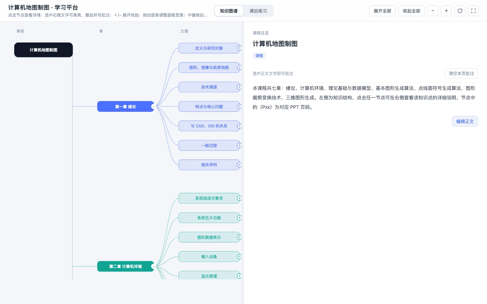

## 前言

这学期有门「计算机地图制图」。课件按章分了七个文件夹，课后题和答案是两份 Markdown，押题又是另外一份。复习到「扫描线填充」的时候，我得同时开着课件、题库和导图，来回切窗口找对应的地方。

所以我想要的东西很具体：一张能展开收起的知识树，点一个节点，右边就是这块知识的正文和对应课件页；另一个页签是题库，能答题、记错题、写笔记；正文里看到不顺眼的地方，能直接划词写批注。

最好像个绿色软件，双击一个 HTML 就能用，不用装环境。



## 两天里都干了什么

第一版没有设计稿，基本是想到哪写到哪，时间点按本地文件的改动排：

- 11 月 2 日下午，先把七章知识点整理成 `map-data.js`，一共 7 章、53 个主题、227 个要点；晚上把正文底稿写出来。
- 11 月 3 日中午，题库成型，167 道题：作业 88、思考题 55、押题 24。14:37 做了第一次提交，22 个文件、约 5870 行。
- 11 月 3 日晚上，把批注模块重写了一遍，加了课后题答案区的批注侧栏，补了一份样式规范。

仓库后来被压成了一次初始化提交，所以这里的时间是按本地文件的改动时间整理的，不是提交记录。

## 只能用原生 JS

第一版就定了两条：只用原生 HTML/CSS/JS，不引框架；不上构建工具。

第二条不是洁癖。`file://` 下浏览器会拦截 ES Module，想双击就开，就不能用 `import/export`。最后所有模块都写成 IIFE，挂到 `window` 上的全局对象里，入口页按固定顺序把这些 script 引进来。第三方库也只有两个，`web-highlighter` 和 `rough-notation`，都下载到 `assets/vendor/`，不依赖 CDN。

代价是模块加载顺序变成了隐式约定，后面的脚本默认前面的全局对象已经存在。好处是改完刷新就生效，发给同学也只是压缩一个文件夹。

## 知识树长什么样

导图数据是嵌套对象，四层：课程、章、主题、要点。

```js
window.MAP_DATA = {
  name: "计算机地图制图",
  d: "课程简介正文",
  children: [
    {
      name: "第一章 绪论",
      color: "#4C6FFF",
      children: [/* 主题，再往下是要点 */]
    }
  ]
};
```

节点的 `d` 是右侧面板的正文，换行用 `\n`；章的 `color` 会被下面的节点继承，所以章节点不写颜色，连线就会变透明。节点名里如果带 `（P12）`，面板底部会自动插入 `slides/ch1/p012.jpg` 这张课件截图，省得我一张张往数据里写图片路径。

布局是用 SVG 手写的：每一层算一个 x，同一层的节点按顺序往下排 y，节点宽度按字数估。展开收起做的事情，就是把折叠节点的 children 从布局列表里排除，再重排一次；缩放平移改的是根节点的 `transform`。

两个页签的界面来自两套不同的模板，样式很容易互相污染。最后的办法是给每个容器加前缀，`#mapView` 和 `#quizView` 下面的规则各管各的，这条后来写进了 `docs/05`。

## 把 167 道题装进去

题目分三个来源，对应卡片上三种颜色的标签：

| 来源 | 数量 | id 前缀 |
|---|---|---|
| 课后思考题 | 55 | `q01`… |
| 押题 | 24 | `y01`… |
| 1-3 章作业 | 40 | `hw13-01`… |
| 4-7 章作业 | 48 | `hw47-01`… |

`id` 全局唯一，答题记录拿它当主键，改一次 id 等于把这道题的历史全丢了。`chapter` 必须和导图里的章名一字不差，连序号和空格都要对上，不然章节筛选和联动都会失效。这两个坑我在整理数据的时候各踩过一次。

题库这边做了章节、题型、状态三个筛选，状态分全部、未练习、有错题、已做对。作答记录、错题笔记都写在本地，另外留了导出和导入，方便换设备。

押题和知识点之间没有现成的对应关系，我分了两步：24 道押题人工核对，直接在 `app.js` 里用 `KP_OVERRIDE` 指定节点；剩下的题按本章节点的关键词打分，再加一个最长公共子串兜底，取分数最高的两个节点。这样点题目上的章节标签，就能跳回导图里大致对应的位置。

## 划词批注

划词高亮用的是 `web-highlighter`，它保存的锚点不是「第几个字符」，而是「第几个同标签元素 + 元素内第几个字符」。这样做的好处是正文重排后还能还原，坏处是正文改动太多时，旧批注会找不到原来的位置。

我的处理是失效的条目静默跳过，不影响同一节点下的其他批注。这条限制现在也写在文档里：改节点正文之前，先想想上面的批注还要不要。

导图批注按知识点的全路径当 key，比如「第一章 绪论 / 定义与研究对象 / 定义：机助制图 CAC」，换节点就换一份批注。课后题是另一种情况：每道题的答案区各持有一个 `AnnoCore` 实例，按题目 id 分组，清单交给 `AnnoAside` 渲染。圈划用 `rough-notation` 画方框，只有圈划没有文字的记录，就只存字符偏移。

## 第一版的问题

纯前端版本用 `localStorage` 存数据，用了两天就发现不对：

1. 数据跟着浏览器走。换成另一个浏览器，或者换台电脑，复习记录就没了。
2. 批注没有导出。题库有导出按钮，批注没有，想备份只能去翻 DevTools。
3. 两套状态对不上。有一次我一边开着 `file://`，一边开着本地服务，同一个知识点在两个窗口里的批注不是同一份。

这三个问题都指向同一件事：需要一个能落盘的地方。于是 11 月 5 日又写了个本地服务，把 SQLite 和 AI 评分接了进来。这部分放在下一篇：


