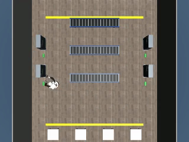

机器人比赛里最让人头疼的失败，不是代码报错，而是每一步日志看起来都对，物理上就是差一点。这篇记两个这样的问题，都发生在调动作的那几周。

## 问题一：按钮，六个点全够不着

场景二每柜的动作序列里有一项"按释放按钮"，判定条件是按钮的滑动关节行程 ≥6mm（总行程 8mm）。r02 轮实跑，六个候选按压点全部 `reached=false`。更糟的是连锁反应：按钮按不下去 → 拉门报 `handle_release_failed` → 门只开了 0.0173 rad（要求 ≥0.30）→ 识灯直接失败。一个按钮串掉了三个环节的分。

### 量出来到底差多少

我没有猜，直接量。pregrasp 位到按钮 gate 点实测距离 0.263m；右臂在第 61 步左右逼近到 0.057m，然后开始发散，最后停在 0.543m——离按钮差着大半个身位。

接着做对照：

- 基线内收 0.08m，gate 能到了（残差 0.017m），但 24 次 4mm 步进只推进了约 6mm，按钮行程一直是 0——够得着，按不动；
- 内收 0.16m，压入深度还是只有 -0.037m，碰都没碰到按钮面。

到这里结论已经清楚了：**"名义停靠位 + 0.055m gate + 4mm×24 步"这整套动作和这条臂的臂展物理上不匹配**。不是参数没调好，是动作结构本身就不成立。

r02 轮的俯视画面，Tiago 正停在柜前准备按压：

### 重做动作结构

方案从"离散步进试探"改成连续伺服：

1. 先受控内收约 0.10~0.16m，分小块动基座，主动把臂展缩短；
2. 然后连续伺服到按钮面，每步读 `release_button_travel`，到 0.0065 或 `latch_unlocked` 就提前停，同时限制最大压入深度 0.012m，防止过冲顶坏接触约束；
3. 按完把基座退回名义停靠位再拉门，保住下游动作的几何关系；
4. 兜底：门平面内 ±0.012m 的候选重试，最多 6 次。

这里有个绕不开的矛盾：到达分要求停在名义停靠位，按压成功又要求基座凑近。找折中停靠点没用，我的做法是分阶段——先在名义位拿到达分，临时改变位姿去按压，完了退回去继续。

## 问题二：门压到位了，被自己的夹爪拖开

场景一关门的坑更隐蔽。修复版已经能把门从 0.312 压到 0.0439（阈值 0.08 以内），但 r22 轮实测暴露了新问题：第一轮压到 0.0067，**切向滑移脱手的时候把门拖回 0.5385**；第二轮压到 0.0481，又拖回 0.4438，最终 `door_not_closed`。

代价不只是多花 50 秒。`fully_successful` 变 false 触发 0.6 的完成系数，用时和效率分全部打折——四柜总分因此停在 84/90。这比那 50 秒贵多了。

复盘时做了个很有价值的动作：先别急着改，复核最新基线。结果发现 r22/r23 里抓取已经全部一次成功，之前计划里"大面积改抓取"的方案对应的场景**早就不存在了**。真正的问题只剩一个：c2 关门第二轮。最后"门达标就沿法向脱手、不做切向滑移"（r23 的改动）绕开了这个坑。

## 记下来的几条

- 物理不可达要量化。"差 0.057m"和"差很多"是两种病，前者改站位，后者改动作结构，靠感觉猜会两头浪费时间；
- 连锁失败从最上游修起，下游经常自己就好了；
- 到达和操作经常几何互斥，分阶段改位姿比折中靠谱；
- 物理交互的动作必须有预算：最大尝试次数、最大压入深度、提前停条件。没有止损的按压动作本质上是随机数生成器；
- 改代码之前先确认问题还在不在。28 轮迭代里最贵的浪费，就是对着上一轮的残影做优化。

> 项目源码：[github.com/aidon-chen/robot-arm-simulation](https://github.com/aidon-chen/robot-arm-simulation)
