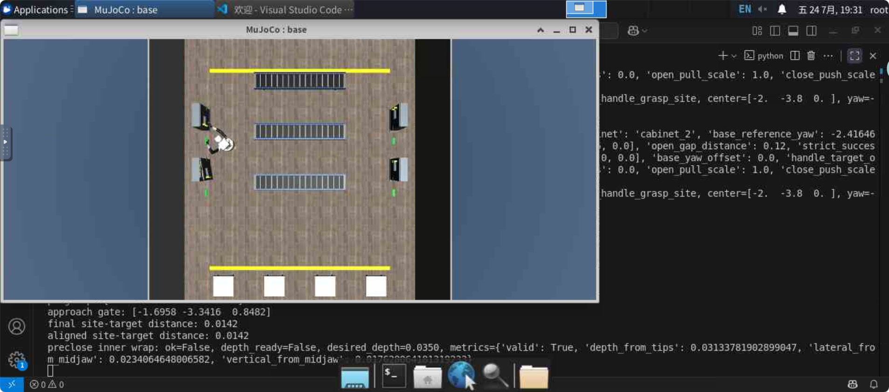
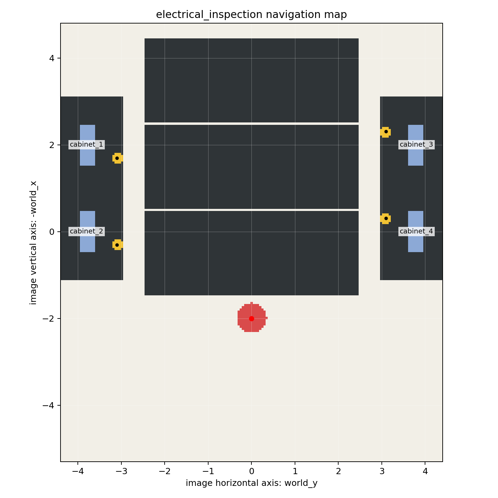

## 前言

今年参加了 2026 无人系统具身智能算法挑战赛的电力柜巡检赛项，前前后后做了快两个月。任务说白了就是：在仿真场景里控制一台 Tiago 机器人，自己走到电力柜前面，开门、看指示灯、读电压表，有些柜子还得把门关上，全程没有任何人工干预。

比赛打完想把过程沉淀成几篇文章，这篇先讲赛题和整体架构，读表、机械臂控制和迭代方法后面各写一篇。

## 赛题

比赛给了两个 MuJoCo 场景，二选一：

- 场景一：四柜巡检，导航 → 开门 → 识指示灯，满分 90；
- 场景二：四个指针表柜，导航 → 读表 → 按按钮 → 拉门 → 识灯，满分 100。

场景二每个柜子 15 分，拆得很细：到达 2 分、读表检测 1 分、读表精度 3 分、释放按钮 2 分、开门 2 分、指示灯可见 2 分、判断颜色 3 分。另外还有安全分和用时、效率分——但有个容易忽略的规则：只有把完整四柜计划跑完，用时和效率分才算数。也就是说中途放弃拿的"部分分"其实很不划算。

任务文本是自然语言，而且是真的会生效的。你输入"巡检2号柜"，机器人就真的只去 2 号柜；输入"巡检全部柜子"才跑完整计划。所以 Planner 必须理解任务文本，背一个固定序列糊弄不了。

## 环境长什么样

官方工程基于 MuJoCo 和 robosuite，机器人是 Tiago，底盘加两条 7DoF 机械臂，头顶一个相机。仿真场景俯瞰是这样的，四个柜子围着中间的通道：





有一条规则对整个方案影响最大：选手只能改 `team_submission/` 下的几个文件（Planner、Workflows、Skills、Knowledge），`app.py`、`src/robot_agent/`、场景模型、Runner 和评分代码全是固定工程，动不了。算法只能通过公开的 Backend 接口拿观测、发指令。

不能改裁判、不能改物理参数，能做的只有在给定接口里把算法做到最好。

## 为什么让 LLM 只做计划

整套系统里我自己最满意的一个决策，是把 LLM 的职责死死限制在"任务文本 → Skill 计划"这一层：

```
任务文本（"巡检全部柜子"）
    │
    ▼
LLM Planner（九格 4B）          ← 只输出结构化 Skill 计划 JSON
    │
    ▼
Workflow（每柜 move → read → press → pull → inspect）
    │
    ▼
Skills（导航 / 开门 / 读表 / 识灯，全部确定性算法）
    │
    ▼
公开 Backend 接口（观测 + 动作）
```

比赛手册也划了两条线：九格 4B 只用于任务规划，不驱动机器人关节、不参与感知和判定；Skill 是否物理成功由裁判用仿真状态重新核实，选手的 payload 必须和评分口径一致，自报成功无效。

这和我自己的想法是一致的。LLM 擅长理解"巡检全部柜子"这种模糊的话、把任务拆成步骤，但让它输出关节角度，或者判断"门到底开了没开"，既不可靠也说不清理由。感知和控制交给确定性算法——A* 导航、闭环拉门、基于图像的读表——LLM 只负责按正确的顺序把正确的目标拼起来。事实证明这条边界划对了，后面几轮几乎没有在 Planner 层面出过问题。

## Skills 里都有什么

- 导航：A* 路径规划加停靠位姿对准，裁判判定是半环带（径向 0.35m、偏航 0.45rad）；
- 开门关门：拉门时每一步都读 `handle_position` 做闭环，失败有重抓取和救援逻辑；关门是"压门 → 切向滑移脱手 → 分级外撤"的迭代，不然夹爪松开时会把门又拖开（这个坑后面专门写）；
- 感知：识灯和读表都从头部相机 320×240 的 RGB 图出发，纯 numpy 手写——judge 环境只有 imageio 和 numpy，连 opencv 都没有；
- 知识库：每轮跑出来的边界值和踩坑结论沉淀成 SOP，注入 Planner 的 prompt，让计划层少犯同样的错。

## 小结

这个赛题有意思的地方，是它把"具身智能"切成了很诚实的三层：语言层给 LLM，感知层给经典 CV，控制层给闭环伺服。每层用什么技术不是拍脑袋，是被环境约束（没有 GPU、依赖固定、评分可复核）推出来的选择。

下一篇写读表：表盘只有 27 像素大，指针不到一个像素宽，怎么在不用任何视觉库的情况下把电压值读出来。

> 项目源码：[github.com/aidon-chen/robot-arm-simulation](https://github.com/aidon-chen/robot-arm-simulation)
