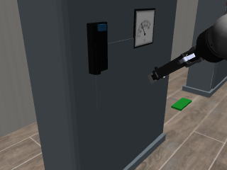
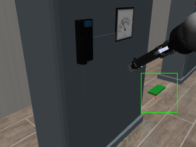

## 问题

比赛场景二要求机器人读指针式电压表。量程 0–500V，步长 10V，扫角 135°，误差不超过 10V 才有精度分。

约束比任务本身更麻烦：

- 观测来自头部相机，实测 320×240；
- 表盘在画面里就 27px 左右，指针长约 11px、宽约 2mm——**不到一个像素**；
- judge 环境依赖只有 imageio 和 numpy，没有 torch，没有 opencv；
- 表盘的精确位姿不在公开元数据里，只能从图像找。

第一次写这东西的时候我对着真实的调试帧看了很久才意识到，这根本不是一个"边缘检测 + 霍夫变换"的问题——目标太小了，小到任何依赖边缘的经典方法都不稳。

## 第一版：翻车

最直觉的做法：灰度化 → 全局亮度阈值 → 面积和长宽比过滤 → 找亮斑当表盘。

跑 r02 轮的时候，算法"成功"定位到了一个框。可惜不是表盘，是画面右下角的一块绿色地面标志。真表盘太暗太小——28×52px，灰度均值 82，柜门背景 52——全局阈值下只剩碎片，全被面积过滤丢了；绿色地标对比度高、面积大，反而全票通过。

调试帧长这样，绿框离表盘十万八千里：

overlay 版本看得更清楚：

那一轮读出来 170V，真值 210V，误差 40V，精度分基本没了。

## 第二版：三重约束定位

修复的思路是不再用全局信息，改成三个便宜的局部判断叠加：

1. **局部对比度**：15px 盒均值，阈值 15。表盘比它周围的局部背景亮，跟全图最大值无关；
2. **饱和度约束**：`max - min ≤ 25`。绿色地标这种高饱和色块一行代码排除，这个判断便宜到离谱但极其好用；
3. **上部中央 ROI**：停靠位姿保证表盘一定出现在画面上部中央，这是免费的几何先验。

离线在归档帧上验证：表盘 bbox 定位成功，用后面要说的读数链路读出 210V，误差 0。顺带发现置信度只有 0.138，低于我原先 0.25 的阈值——51 个候选值挨得太近，best 和 second 本来就拉不开差距，阈值必须降到 0.10。

## 读数：不找指针，反向验证

读数这块我最后完全放弃了"检测指针再算角度"的路线。指针不到一个像素宽，边缘方向都算不稳。换个思路：**假设指针指着某个值，问图像支不支持**。

- 51 个候选值，每个对应一个角度 `θ = 135° × v/500`；
- 轴心位置有个几何先验（表盘中心下方约 28% 高度），在正视图里 ±3px 小范围搜索；
- 对每个候选角度，从轴心沿方向采样一段半径，取采样点的平均暗度做响应，垂直方向 ±0.5px 取最小值去匹配细线；
- 响应最大的候选就是读数，再用相邻三点抛物线插值细分角度，最后吸附到 10 的倍数；
- 置信度 = (best − second)/best，太低就报失败。读错了比读不出更亏。

最后连采 3 帧，各自走完整链路再取中位数，压掉单帧反光和遮挡的跳变。

## 几点体会

- 第一版翻车的根子是我对输入的假设太乐观。要是动手前先把真实帧上的表盘量一遍（灰度多少、多大、和背景差多少），那条弯路根本不会存在；
- 饱和度过滤是个被低估的技巧。绿色地标、红色按钮这类干扰源，一行判断全部清空；
- 目标极小、形状已知、候选有限的时候，匹配滤波比任何边缘方法都稳。51 个候选反向验证，比在一堆亚像素边缘里挑一根"指针"容易太多；
- 阈值不要抄经验值。候选越密，置信度的分布就越低，0.25 在这里就是筛掉所有正确答案。

> 项目源码：[github.com/aidon-chen/robot-arm-simulation](https://github.com/aidon-chen/robot-arm-simulation)
