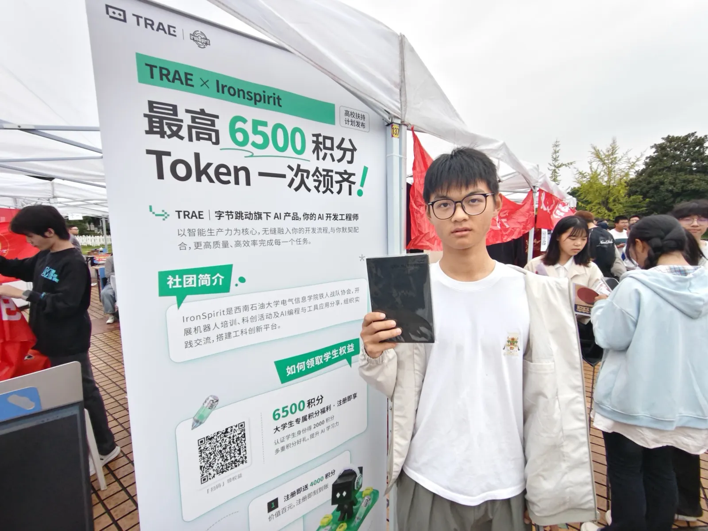
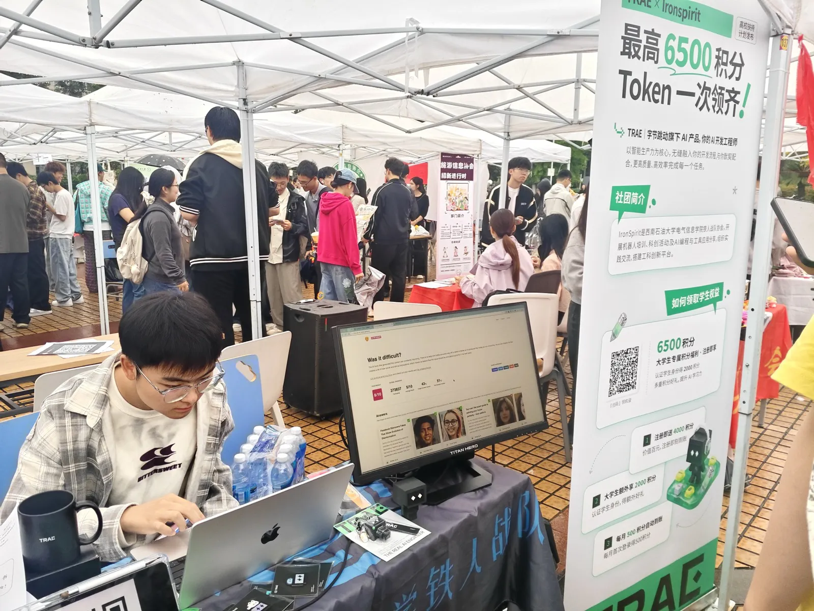
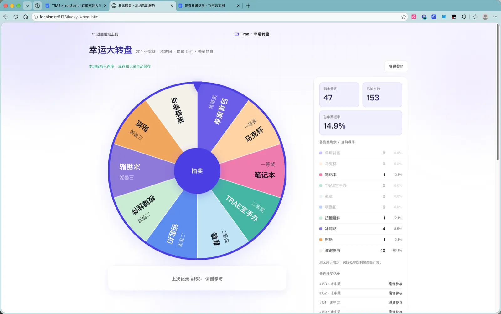
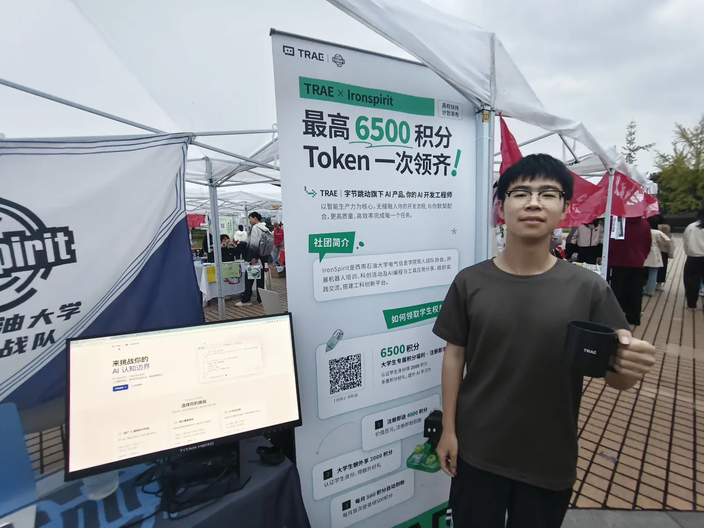

## 前言

10 月 10 日，TRAE 和学院的 IronSpirit 战队一起在西南石油大学摆了个摊，主题是高校扶植计划——扫码认证学生身份，把积分和 Token 一次领齐。

我在这件事里负责的是摊位上的技术部分：活动主页、AI 快问快答、还有那个幸运转盘。听起来像三个静态页面，但真正麻烦的是转盘背后的奖品库存——现场不可能允许"刷新一下多抽一次"这种事发生。

这篇把整个过程记下来，包括为什么最后写了个本地服务、现场出了哪些岔子。

## 摊位长什么样

白棚子、横幅、两台显示器、一台笔记本，桌上摆着手办、徽章、贴纸、马克杯和冰箱贴。横幅上印的是"最高 6500 积分 Token 一次领齐"，旁边还有 IronSpirit 的社团介绍和领取流程。

我们的流程很简单：路过的人先扫码认证，然后来摊位做一个小互动，完成之后拿抽奖机会。

互动有两个可选——AI 快问快答，或者幸运转盘。实际跑下来大部分人两个都想玩。

## 为什么页面要自己写

主办方给的物料主要是横幅和二维码，互动部分没有现成的东西。摆摊又不能指望网络——学校那片场地信号时好时坏，所以我从一开始就按"完全离线可用"来设计：除了首页那个领积分的二维码，其余功能都不依赖外网。

三个页面分工是：

- **活动主页**：活动简介、奖品、两个入口，负责把路过的人留住看两眼；
- **快问快答**：81 道题，每题 5 秒，五题全对可以换一次抽奖；
- **幸运转盘**：抽奖和奖品发放。

视觉上做了统一：紫靛色主色，首页 hero 区加了两个相位相反的海浪式光斑动画，一是好看，二是能让摊位屏幕上有点动的东西，比一张静止的海报更吸引人。

## 快问快答：81 道题是怎么凑出来的

题库是两份合并的。我这边原来有一份 18 道的 AI 圈梗题，仓库里还有一份 63 道常识题，按题目 ID 合并之后一共 81 道，每轮随机抽 5 道，选项顺序也打乱。

规则定得很克制：每题 5 秒，答错或超时就结束。这样一局最长不到半分钟，后面排队的人不会等太久。全对才给抽奖机会——不是故意为难人，而是如果随便答完就能抽，摊位上会变成"点两下就走"，反而不像互动。

实际效果比预期好。梗题那部分现场反应最热烈，很多人是看到题目笑出来才愿意坐下来玩的。

## 转盘不能只写前端

最初的版本是纯前端抽奖：奖品数量写死在 JS 里，抽一次用 `localStorage` 记一下。自己演示完全够用，摆在摊位上就是另一回事了。

问题出在三个地方：

1. **同一台电脑开两个浏览器会各抽各的**。现场为了展示，笔记本外接了显示器，浏览器不止开一个，前端库存是两份。
2. **刷新就重置**。有人抽完刷新页面，状态回到初始，虽然记录还在，但剩余的库存数字对不上。
3. **重启就没了**。活动分两天，晚上关机，第二天要接着用剩下的奖池。

所以我改成写一个很小的本地服务：Node.js 起一个 HTTP 服务，奖品库存和抽奖记录放 SQLite。没有第三方依赖，不需要 `npm install`，现场只要机器上有 Node 就能跑。

核心逻辑其实就几条：

- 一次抽奖一个请求编号，同一个编号重复提交只返回第一次的结果，不会重复扣库存；
- 扣库存和写记录放在同一个事务里，避免并发下出现"记录写了但库存没减"；
- 中奖概率按剩余数量动态算，不是固定值——奖池越抽越薄，概率自然往下走；
- 服务只绑定 `127.0.0.1`，只有现场那台工作人员电脑能用，不开放局域网入口。

后面这几条现在看都是常识，但当时是被现场逼出来的。比如"按剩余数量算概率"这件事，最初文档里写的 29% 中奖率是初始值，很多人（包括我）会误以为全程都是 29%。实际发出去 58 份实物，抽得越多，剩下的比例越低。

## 数据

两天一共抽了 153 次，发出去 51 份实物，整体中奖率大概三分之一。

具体分布：冰箱贴 11、笔记本 9、贴纸 9、按键挂件 5、TRAE 宝手办 5、马克杯 5、钥匙扣 3、徽章 2、单肩背包 2。

后台是我自己用的面板，快捷键 `Ctrl/Cmd+Shift+A` 调出来，能看到每种奖品剩多少、最近记录、以及导出全部抽奖记录。收场之后导出 CSV 核对了一遍，和实际发出去的礼品数量能对上。

这一步很重要。现场发礼品是人工的，抽奖记录是程序写的，两边一旦对不上，第二天就没法解释。所以服务在启动时、每 20 条新结果、以及每次管理操作之前都会自动备份数据库文件，收场时再手动导一份完整的。

## 现场踩的坑

**缓存按域名隔离。** `localhost:5173` 和 `127.0.0.1:5173` 访问的是同一个后端，但浏览器的 `localStorage` 是分开的。中途换过一次地址，结果出现了"旧记录提示"，只能先导出旧记录、核对已发礼品，再选择迁移。

**问答和转盘没有自动联动。** 快问快答全对之后，程序不会自动给抽奖资格，是工作人员看过结果在转盘那边人工放行。听起来很土，但现场其实更稳——不会因为网络或者误操作多发机会，也不会出现有人连点。

**奖品数量改了好几次。** 活动前一天晚上还在调奖池，把单独设的一等奖手办并进了"TRAE 宝手办"，从 4 份改成 5 份。这类改动必须同步改测试断言，否则第二天跑检查会直接红。

**必须留回退点。** 每个大改动之前我都会记一个提交哈希。抽奖服务是独立提交的，出问题能一条 `git revert` 退回到纯前端那版——虽然退回去库存就管不住了，但至少活动能继续。宁可有个能用的退路，也不要现场盯着报错改代码。

## 记一笔

摆摊和写代码是两种完全不同的事情。写页面的时候想的是"功能对不对"，站到摊位后面才发现真正的问题是：排队的第三个人开始不耐烦了没有、屏幕上那个数字工作人员看不看得懂、有人刷新了页面要不要重来。

我做的三个页面没有多复杂的技术，但它们在现场确实撑住了两天的量。回来之后我又补了后台的奖池管理功能，下次活动不用改代码就能换奖池——这大概是最实际的一条收获：**能被下一个人直接用起来的东西，才算真的做完。**

